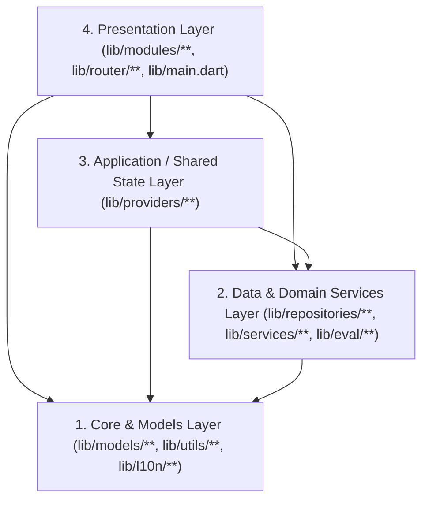

# Mangayomi Architecture Reference

> **Status:** Active Architectural Contract  
> **Companion Document:** [`docs/design/DESIGN.md`](../design/DESIGN.md) (Visual & UI System)  
> **Automated Enforcement:** [`test/core/architecture/architecture_test.dart`](../../test/core/architecture/architecture_test.dart)

---

## 1. Purpose & Core Philosophy

Mangayomi is a multi-platform, multi-media client (Manga, Anime, Light Novel) supporting multiple extension runtimes (Dart, JavaScript, MBridge, Aidoku/Wasm), offline archiving, tracker synchronization, and P2P/server sync.

To guarantee high maintainability, performance, and long-term stability, the codebase enforces a **Layered Feature-First Architecture** with **strict unidirectional dependency rules**.

---

## 2. The Four Architectural Layers

Mangayomi enforces a strict **top-down dependency graph**. Higher layers may import lower layers; **lower layers must never import higher layers**.



### Layer 1: Core & Models (`lib/models/`, `lib/utils/`, `lib/l10n/`)
- **Responsibility:** Pure data structures, Isar collection schemas, serialization (`fromJson`/`toJson`), pure formatting/parsing utilities, and localization strings.
- **Allowed Imports:** Dart/Flutter SDK primitives, third-party data packages (`isar_community`, `collection`, `path`).
- **Forbidden Imports:**
  - `package:mangayomi/modules/...`
  - `package:mangayomi/services/...`
  - `package:mangayomi/providers/...`
  - `package:mangayomi/main.dart`

### Layer 2: Data & Domain Services (`lib/repositories/`, `lib/services/`, `lib/eval/`)

#### 2A. Repositories (`lib/repositories/`)
- **Responsibility:** Single gateway to the local Isar database (`lib/repositories/db.dart`). Encapsulates queries, transactions, batch writes, and sync-change tracking (`changedPartRepository`).
- **Contract:**
  - Must be **100% UI-agnostic and Riverpod-agnostic**.
  - **Never** import `package:flutter_riverpod/flutter_riverpod.dart` or accept `WidgetRef` / `Ref` / `BuildContext`.
  - **Never** import `package:mangayomi/modules/...`, `package:mangayomi/services/...`, `package:mangayomi/providers/...`, or `package:mangayomi/main.dart`.
  - **Index-First Lookups:** All queries must leverage Isar B-Tree indexes (`.where()`) rather than full-table scans (`.filter()`) on indexed fields (e.g., `mangaId`, `itemType`, `isRead`, `favorite`).
  - When a repository mutation needs to record a sync delta, it calls `changedPartRepository.recordIfSyncOn(...)` directly within the data layer.

#### 2B. Domain & Infrastructure Services (`lib/services/`, `lib/eval/`)
- **Responsibility:** Extension runtime execution (`lib/eval/`), HTTP/WebView networking (`lib/services/http/`), background library updates, chapter/video extraction, local archive scanning, tracker OAuth/API clients (`lib/services/trackers/`), and sync engines (`lib/services/sync/`).
- **Contract:**
  - May depend on `lib/models/`, `lib/repositories/`, `lib/utils/`, `lib/eval/`, and shared application providers in `lib/providers/`.
  - May use Riverpod `Ref` (inside `@riverpod` functions/notifiers), **never** `WidgetRef` (which belongs exclusively to Flutter `ConsumerWidget` / `ConsumerStatefulWidget`).
  - **Never** import `package:mangayomi/modules/...` or `package:mangayomi/main.dart`.
  - **Background Isolate Offloading:** Heavy CPU or I/O operations (Zip/GZip archive extraction, decompression, AES encryption/decryption, large JSON parsing) must be offloaded to `Isolate.run()` to prevent blocking the Flutter UI thread.

### Layer 3: Application & Cross-Feature State (`lib/providers/`)
- **Responsibility:** Cross-cutting application state (storage paths, sync state, tracker credentials, global browse/security/incognito settings) consumed by multiple features or background services.
- **Contract:**
  - Uses `@riverpod` code generation (`riverpod_annotation`).
  - Reads and mutates data through `lib/repositories/` and `lib/services/`.
  - **Never** imports UI screens or widgets from `lib/modules/`.
  - **Rebuild Granularity:** High-frequency watchers must use `.select(...)` to isolate rebuilds and prevent cascaded re-renders of the widget tree.

### Layer 4: Presentation & Feature Modules (`lib/modules/`, `lib/router/`)
- **Responsibility:** Feature-scoped screens, reusable widgets, dialogs, and feature-specific view controllers/notifiers.
- **Structure of a Feature Module (`lib/modules/<feature>/`):**
  ```text
  lib/modules/<feature>/
  ├── controllers/   # View-state orchestration, gesture/keyboard handlers, timers
  ├── models/        # UI-only value objects (view modes, filter chips, sort states)
  ├── providers/     # Feature-scoped Riverpod notifiers and derived state
  ├── widgets/       # Pure, composable UI components (< 350 lines each)
  └── <feature>_screen.dart
  ```
- **Contract:**
  - Feature modules may import `lib/models/`, `lib/repositories/`, `lib/services/`, `lib/providers/`, and `lib/utils/`.
  - **Cross-Feature Isolation:** Sibling media features (`manga`, `anime`, `novel`) must not import each other's internal widgets or controllers.
  - **Shared Reader Infrastructure (`lib/modules/reader_common/`):** Shared reading logic (chapter navigation, reader app bars, gestures, orientation, auto-scroll) resides in `reader_common/`, which must never import a concrete reader implementation.
  - **Shared Widgets (`lib/modules/widgets/`):** Generic, feature-agnostic UI components reside in `lib/modules/widgets/` and must never import feature modules.
  - **Memory Management in Readers:** Readers must coordinate with `DecodedImageBudget` to bound decoded image textures, releasing pixels on `dispose()` and responding to system `didHaveMemoryPressure()` callbacks.

---

## 3. Non-Negotiable Architectural Rules

### Rule 1: Never Import `lib/main.dart`
`lib/main.dart` is the application bootstrap entrypoint. Importing `main.dart` from lower layers creates circular dependencies and breaks automated testing.
- Database instance (`isar`) lives strictly in [`lib/repositories/db.dart`](../../lib/repositories/db.dart).
- HTTP / WebView globals (`webViewEnvironment`, `customDns`) live in [`lib/services/http/m_client.dart`](../../lib/services/http/m_client.dart).

### Rule 2: Zero `lib/modules/` Imports in Lower Layers
If a class, enum, model, or provider is needed by `lib/services/` or `lib/repositories/`, **it does not belong in `lib/modules/`**:
- Shared data models belong in `lib/models/`.
- Shared state providers belong in `lib/providers/`.
- Shared domain/archive/file logic belongs in `lib/services/`.

### Rule 3: `WidgetRef` Stays in the Widget Tree
- `WidgetRef` is a Flutter widget-tree handle. Passing `WidgetRef` into repositories or services couples data operations to an active widget lifecycle and causes `"Cannot use ref after the widget was disposed"` crashes during async work.
- Repositories must take plain Dart parameters.
- Services must either take plain Dart parameters or operate inside a Riverpod provider/notifier using `Ref`.

### Rule 4: Lean Views & File Size Limits
- **Target size:** Widget files should stay under **350 lines**; Screen/View files under **500 lines**.
- **Absolute ceiling:** No file in `lib/modules/` may exceed **1,400 lines** (enforced by automated CI tests).
- **No direct Isar queries in `build()`:** Widgets must never call `isar.<collection>.filter()...` directly inside `build()`. All database reads go through a Repository and are exposed via Riverpod.
- **Decompose Interactive Views:** Complex interactive screens (Manga Reader, Anime Player, Novel Reader) must separate:
  1. **Viewport rendering** (pure widget tree)
  2. **Overlay & HUD bars** (top/bottom bars, sliders, settings sheets)
  3. **Session Controller / Notifier** (position state, preloading, history, tracker sync)
  4. **Input Handler** (keyboard shortcuts, pointer/tap zones, volume keys)

### Rule 5: Database Index Optimization
- Repository methods must query via indexed B-Tree access (`.where()`) whenever an index exists.
- Table scans (`.filter()`) should only be used for non-indexed secondary filtering on already-narrowed result sets.

### Rule 6: Heavy Compute Offloading
- Operations involving archive extraction (Zip/GZip), cryptographic decryption, or decoding large JSON streams must run in a background isolate via `Isolate.run()`.

---

## 4. Verification & CI Guard-Rails

Every commit and pull request must pass the automated architectural boundary suite:

```bash
flutter test test/core/architecture/architecture_test.dart
```

This test suite statically inspects all `.dart` files under `lib/` and fails immediately if:
1. Any file in `lib/repositories/` imports `lib/modules/`, `lib/services/`, `lib/providers/`, `lib/main.dart`, or `flutter_riverpod`.
2. Any file in `lib/services/`, `lib/models/`, `lib/eval/`, or `lib/utils/` imports `lib/modules/` or `lib/main.dart`.
3. Any file in `lib/repositories/` or `lib/services/` declares a dependency on `WidgetRef`.
4. Any file in `lib/modules/widgets/` imports feature-specific modules (`lib/modules/manga`, `anime`, `novel`, etc.).
5. Any file in `lib/modules/reader_common/` imports a concrete reader implementation.
6. Sibling media modules (`manga`, `anime`, `novel`) import each other directly.
7. Direct Isar database access (`db.dart`) is imported outside `lib/repositories/` and bootstrap.
8. Any module file in `lib/modules/` exceeds the 1,400-line ceiling.
